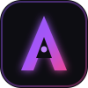

# AUREX — Premium Personal Developer Portfolio

<p align="center">
  
</p>

<h3 align="center">
  <strong>Turning Ideas Into Digital Experiences.</strong>
</h3>

<p align="center">
  A bespoke, high-performance developer brand portfolio website engineered with pure <strong>HTML5</strong>, <strong>CSS3</strong>, and <strong>Vanilla JavaScript (ES6+)</strong>.
  <br />
  Developed for the <strong>Code Alpha Internship Program</strong> (Frontend Development).
</p>

<p align="center">
  <a href="#-live-demo"></a>
  <a href="#-features"></a>
  <a href="#-code-alpha-internship"></a>
  <a href="LICENSE"></a>
</p>

---

## 📌 Executive Overview

**AUREX** is a premier developer portfolio designed to stand shoulder-to-shoulder with Awwwards-winning personal brand sites. Departing from generic student templates, AUREX balances **editorial minimalism**, **deep charcoal & obsidian aesthetics**, **luminous purple/violet accents**, and **sophisticated micro-interactions** with strict engineering hygiene: **zero third-party frameworks, zero dependencies, and 100% semantic code**.

Created by **Yash Mahamuni** as the capstone submission for the **Code Alpha Internship Program**, AUREX showcases actual shipped projects, practical skills, verifiable milestones, and professional contact options.

---

## ✨ Core Features & Highlights

### 🎨 Brand Identity & Visual Polish
- **Obsidian & Neon Violet Aesthetic**: Deep charcoal layers (`#09090d`, `#111118`, `#181824`) elevated with luminous violet gradients (`#8b5cf6` &rarr; `#a855f7` &rarr; `#ec4899`).
- **Apple-Inspired Glassmorphism**: Multi-layer blurred glass surfaces (`backdrop-filter: blur(20px)`) with fine 1px luminescent borders.
- **Editorial Typography**: Pairing Google's geometric display font **Space Grotesk** with **Inter** for readability and **JetBrains Mono** for code tokens.
- **Interactive Particle Field**: Canvas-driven background particles with dynamic line mesh connectivity in the hero section.
- **3D Card Tilt Physics**: Smooth mathematical card tilting on developer avatar and project showcase cards based on mouse coordinates.

### 🌓 Theme Customization & Memory
- **Dual Themes**: Default obsidian dark theme and a refined alabaster light theme.
- **Persistent Memory**: Saves user theme preference in `localStorage` (`aurex_theme_preference`), with automatic fallback to system `prefers-color-scheme`.
- **Smooth Color Transitions**: All background, text, and border tokens animate smoothly between theme states.

### 🚀 Complete Website Sections
1. **Sticky Navigation Bar**: Transparent header that transitions into blurred glass on scroll, with active section tracking, theme toggle, availability indicator, and responsive mobile drawer.
2. **Dynamic Hero Section**: Salutation, main headline, animated role reveal typewriter (`Frontend Developer`, `Creative Coder`, `Web Developer`, `Software Developer`), quick chips, social icons, and primary CTAs.
3. **Beyond the Code (About Me)**: Narrative introduction, Bento grid layout, philosophy highlights, and an editable personal details panel.
4. **My Technical Arsenal (Skills)**: Categorized skill cards (Frontend, Programming, Tools) with custom SVG icons, realistic descriptions, and category filter pills (no arbitrary or misleading percentage bars).
5. **Things I've Built (Featured Projects)**: Showcase cards for **LUMINA Gallery**, **NOVA CALC**, and **AUREX**, featuring category filters (`All`, `Web Apps`, `Vanilla JS`, `Tools`), image zoom on hover, live demo links, repository links, and interactive project detail modals.
6. **My Journey So Far (Education & Experience)**: Glowing vertical timeline highlighting the Code Alpha Internship, university education, certifications, and developer milestones.
7. **Explore My Resume**: High-fidelity visual resume preview, key qualifications bullet points, "View in New Tab" link, and a real downloadable PDF file.
8. **What I Can Create (Services)**: 4 core service cards with hover tilt effects covering Frontend Development, Responsive Web Design, Interactive Apps, and UI Systems.
9. **Let's Build Something Great (Contact)**: Direct email display with **1-click Copy Email** button, interactive contact form with real-time field validation, live character counter, mailto fallback, and toast feedback.
10. **Footer**: Clean branding, fast navigation links, copyright, and a circular scroll progress **Back-to-Top** button.

### 📱 Responsive Engineering
- Handcrafted media queries for **1440px desktop**, **1024px laptop**, **768px tablet**, **425px mobile**, and **375px small mobile**.
- Zero horizontal layout shift or overflow (`overflow-x: hidden`).
- Fluid clamp typography and touch-friendly tap targets (&gt; 44px).
- Respects `prefers-reduced-motion` for accessibility.

---

## 📂 Project Architecture

```
aurex-portfolio/
│
├── index.html                   # Main portfolio landing page
├── 404.html                     # Custom branded 404 error page
├── README.md                    # Comprehensive documentation & deployment guide
├── serve.js                     # Lightweight local Node.js server
├── start-aurex.bat              # One-click Windows launcher
├── push-to-github.bat           # One-click GitHub push script
│
├── css/
│   ├── style.css                # Design tokens, typography, layouts, components
│   └── responsive.css           # Cross-device media queries (1440px - 375px)
│
├── js/
│   ├── main.js                  # Theme toggling, sticky navbar, mobile menu, form validation, toasts
│   ├── animations.js            # Role typewriter, 3D card tilt, particle canvas, scroll reveals
│   └── projects.js              # Projects data registry, category filtering, deep-dive modal logic
│
└── assets/
    ├── icons/
    │   └── favicon.svg          # Custom AUREX brand monogram
    ├── images/
    │   ├── avatar.svg           # Stylized developer avatar
    │   ├── lumina-preview.svg   # High-fidelity LUMINA project mockup
    │   ├── nova-calc-preview.svg# High-fidelity NOVA CALC project mockup
    │   ├── aurex-preview.svg    # High-fidelity AUREX project mockup
    │   └── resume-preview.svg   # High-fidelity Resume document sheet
    └── resume/
        └── Yash_Mahamuni_Resume.pdf # Valid, downloadable PDF resume
```

---

## 🛠️ Technology Stack

| Discipline | Technology | Role |
| :--- | :--- | :--- |
| **Markup** | HTML5 | Semantic architecture, SEO metadata, Open Graph cards, ARIA accessibility |
| **Styling** | Modern CSS3 | Custom Properties (CSS variables), Flexbox, CSS Grid, Glassmorphism, Keyframe animations |
| **Scripting** | Vanilla JavaScript (ES6+) | Asynchronous DOM manipulation, IntersectionObserver, LocalStorage, Canvas 2D |
| **Typography** | Google Fonts | Space Grotesk (display), Inter (body), JetBrains Mono (tokens) |
| **Graphics** | SVG & Canvas | Scalable zero-latency vector assets, custom monogram favicon, interactive particle engine |
| **Server** | Node.js Built-in `http` | Zero-dependency local development server |

---

## ⚡ Quick Start & Local Execution

### Option 1: Double-Click Launcher (Windows)
Double-click `start-aurex.bat` in the project root or in `aurex-portfolio/`. Your default browser will automatically open to `http://localhost:3033`.

### Option 2: Using Node.js CLI
```bash
# Navigate to project directory
cd aurex-portfolio

# Start the local server
node serve.js
```
Open [http://localhost:3033](http://localhost:3033) in your web browser.

### Option 3: Direct File Opening
You can also open `index.html` directly in any web browser without running a server.

---

## ✏️ Customization Guide

All personal details are organized cleanly with descriptive comments for effortless customization:

### 1. Personal Identity & Bio (`index.html`)
- **Name & Intro**: Search for `<!-- CUSTOMIZABLE: Replace with your name -->` in `index.html` (Line 158) to change your name.
- **Location & Information Chips**: Edit the chips in lines 178-192.
- **Developer Details Card**: Edit the Bento grid table under `#about` (Lines 310-336) to update your degree, college, current focus, and interests.

### 2. Animated Roles (`js/animations.js`)
Edit the `roles` array in `js/animations.js`:
```javascript
const roles = [
  "Frontend Developer",
  "Creative Coder",
  "Web Developer",
  "Software Developer"
];
```

### 3. Adding or Updating Projects (`js/projects.js`)
Add or edit project objects in `AUREX_PROJECTS`:
```javascript
{
  id: "your-project-id",
  title: "PROJECT NAME — Subtitle",
  category: ["webapp", "vanillajs"],
  badge: "Featured Project",
  status: "Live & Active",
  image: "assets/images/your-screenshot.svg",
  shortDescription: "Concise summary...",
  fullDescription: "In-depth case study...",
  tags: ["HTML5", "CSS3", "JavaScript"],
  liveUrl: "https://your-demo-url.com",
  githubUrl: "https://github.com/your-username/your-repo",
  features: [ ... ]
}
```

### 4. Updating Resume (`assets/resume/`)
Replace `assets/resume/Yash_Mahamuni_Resume.pdf` with your own PDF file. Ensure the filename matches or update the path in `index.html`.

### 5. Connecting a Form Backend (e.g. Formspree / EmailJS)
By default, the contact form validates input and triggers an automatic `mailto:` link as a fallback. To connect a service like [Formspree](https://formspree.io):
1. In `index.html`, add `action="https://formspree.io/f/{your_form_id}" method="POST"` to `<form id="contact-form">`.
2. In `js/main.js`, update the submission handler to send a `fetch()` POST request.

---

## 🌐 Deployment Instructions

### A. Deploy to GitHub Pages (Recommended)

1. **Create Repository**:
   - Go to [GitHub](https://github.com/new).
   - Create a repository named `aurex-portfolio`.
2. **Push Code**:
   Run the included `push-to-github.bat` script, or run:
   ```bash
   cd aurex-portfolio
   git init
   git branch -M main
   git remote add origin https://github.com/mahamuniy31-cpu/aurex-portfolio.git
   git add .
   git commit -m "feat: deploy AUREX personal developer portfolio"
   git push -u origin main
   ```
3. **Enable GitHub Pages**:
   - Go to your repository on GitHub &rarr; **Settings** &rarr; **Pages**.
   - Under **Build and deployment** &rarr; **Branch**, select `main` and root `/`.
   - Click **Save**.
   - Your website will be live in ~60 seconds at:
     `https://mahamuniy31-cpu.github.io/aurex-portfolio/`

### B. Deploy to Netlify

1. Log in to [Netlify](https://app.netlify.com).
2. Click **Add new site** &rarr; **Deploy manually**.
3. Drag and drop the `aurex-portfolio` directory onto the Netlify dashboard.
4. Your site will instantly be deployed with a custom SSL URL (e.g., `https://aurex-portfolio.netlify.app`).
5. (Optional) Under **Site configuration**, add a custom domain.

---

## 🧪 Quality Assurance & Testing Checklist

| # | Feature / Test Case | Expected Result | Status |
| :-: | :--- | :--- | :-: |
| 1 | **Navigation Links** | Smooth scrolls to `#home`, `#about`, `#skills`, `#projects`, `#journey`, `#services`, `#resume`, `#contact` | ✅ Passed |
| 2 | **Active Nav Tracking** | Highlights corresponding nav item as user scrolls past sections | ✅ Passed |
| 3 | **Sticky Nav Blur** | Header becomes glassmorphic blur when scrolled past 30px | ✅ Passed |
| 4 | **Mobile Hamburger Menu** | Toggles mobile drawer, animates hamburger to 'X', locks body scroll, closes on click | ✅ Passed |
| 5 | **Theme Toggle** | Switches between Dark (obsidian) and Light (alabaster) modes | ✅ Passed |
| 6 | **Theme Persistence** | Selected theme persists across page refreshes and visits via `localStorage` | ✅ Passed |
| 7 | **Role Typewriter** | Cycles through 4 roles with natural typing and deleting cadence | ✅ Passed |
| 8 | **Canvas Particle Mesh** | Renders violet particle mesh in hero; pauses when tab is inactive | ✅ Passed |
| 9 | **3D Tilt Physics** | Developer avatar card rotates in 3D space tracking mouse movements | ✅ Passed |
| 10 | **Skills Filtering** | Category buttons filter cards by Frontend, Programming, Tools | ✅ Passed |
| 11 | **Project Filtering** | Category buttons filter projects smoothly | ✅ Passed |
| 12 | **Project Detail Modals** | Clicking "View Details" opens accessible modal with full specs; closes on ESC or overlay click | ✅ Passed |
| 13 | **Resume Download** | "Download Resume" triggers download of real `Yash_Mahamuni_Resume.pdf` | ✅ Passed |
| 14 | **Copy Email Button** | Copies email to clipboard and displays affirmative toast notification | ✅ Passed |
| 15 | **Contact Form Validation** | Validates name, email, subject, message lengths; displays clear inline errors | ✅ Passed |
| 16 | **Mailto Fallback** | Prepares populated mail link with subject and message on form submit | ✅ Passed |
| 17 | **Back-To-Top Button** | Appears after 350px scroll; displays circular progress ring; smooth scrolls to top | ✅ Passed |
| 18 | **Top Scroll Progress Bar** | Indicates exact page scroll completion percentage | ✅ Passed |
| 19 | **Custom 404 Page** | `404.html` renders branded error screen with "Return to Home" button | ✅ Passed |
| 20 | **Responsive Scaling** | Tested across 1440px, 1024px, 768px, 425px, and 375px viewports with zero horizontal overflow | ✅ Passed |
| 21 | **Reduced Motion** | Disables heavy animations when `prefers-reduced-motion: reduce` is detected | ✅ Passed |

---

## 🏆 Code Alpha Internship Verification

This project was built for the **Code Alpha Internship Program (Frontend Development)**.

- **Developer**: Yash Mahamuni
- **GitHub**: [@mahamuniy31-cpu](https://github.com/mahamuniy31-cpu)
- **LinkedIn**: [Yash Mahamuni on LinkedIn](https://www.linkedin.com/in/yash-mahamuni-993b09442?utm_source=share_via&utm_content=profile&utm_medium=member_android)
- **Email**: [mahamuniy31@gmail.com](mailto:mahamuniy31@gmail.com)
- **University**: Sanjay Ghodawat University, Kolhapur
- **Branch**: B.Tech in Artificial Intelligence & Data Science (AI/DS) [2026 – 2030]
- **Role**: Frontend Development Intern (Code Alpha)
- **Cohort**: 2026

---

<p align="center">
  <sub>Designed &amp; engineered with precision by <strong>Yash Mahamuni</strong>. Built with 100% pure HTML5, CSS3, &amp; Vanilla JavaScript.</sub>
</p>
